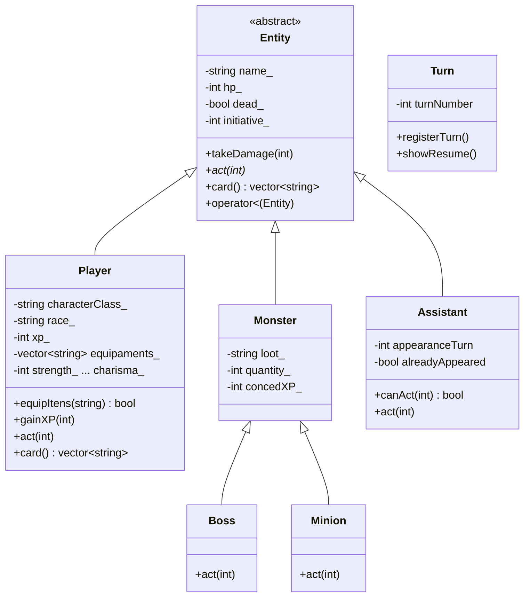

<div align="center">

# ⚔️ RPG em C++ — Programação Orientada a Objetos

**Um mini-RPG de terminal feito para praticar os pilares da Programação Orientada a Objetos em C++.**


</div>

---

## 📖 Sobre o projeto

Este repositório tem um **RPG por turnos jogado no terminal**, escrito em C++ como exercício de **Programação Orientada a Objetos (POO)**.

Heróis, monstros, chefes, lacaios e assistentes são todos **entidades** de uma mesma hierarquia de classes. Cada tipo de personagem tem seus próprios atributos e um comportamento próprio a cada turno. O objetivo não é fazer um jogo completo, e sim mostrar na prática como os conceitos de POO organizam um sistema real.

Hoje o programa:

- 🧙 cria personagens jogáveis a partir de uma **classe** (Crusader, Barbarian, Necromancer) e de uma **raça** (Human, Dwarf, Elf);
- 📊 calcula os atributos (Força, Destreza, Constituição, Sabedoria, Inteligência, Carisma) somando os valores da classe com o bônus da raça;
- 🎒 controla o **inventário**, com um limite de itens que depende da classe;
- 🪪 imprime as **fichas dos personagens lado a lado** no terminal.

---

## 🧠 Conceitos de POO aplicados

| Conceito | Onde aparece |
|---|---|
| **Encapsulamento** | Atributos `private` (`name_`, `hp_`, `xp_`…), acessados apenas por *getters* |
| **Herança** | `Player`, `Monster` e `Assistant` herdam de `Entity`; `Boss` e `Minion` herdam de `Monster` |
| **Classe abstrata** | `Entity` tem o método virtual puro `act(int currentTurn) = 0` |
| **Polimorfismo** | `act()` e `card()` são `virtual` e sobrescritos (`override`) nas classes filhas; o `main` trata todos como `Entity*` |
| **Destrutor virtual** | `virtual ~Entity()` garante que objetos derivados sejam liberados corretamente |
| **Sobrecarga de operadores** | `operator<` compara entidades pela iniciativa; `operator<<` imprime uma entidade com `std::cout` |
| **Função `friend`** | `operator<<` acessa os atributos privados de `Entity` |
| **Lista de inicialização** | Os construtores inicializam os atributos com `: name_(name), hp_(hp), ...` |
| **Funções `static` de arquivo** | `row()` e `text()` em `player.cpp` formatam as linhas da ficha e só existem naquele arquivo |

---

## 🏛️ Hierarquia de classes



---

## 🎲 Regras dos personagens

### Classes (valores base)

| Classe | FOR | DES | CON | SAB | INT | CAR | Limite de itens |
|---|:-:|:-:|:-:|:-:|:-:|:-:|:-:|
| 🛡️ **Crusader** | 14 | 10 | 14 | 12 | 8 | 14 | 7 |
| 🪓 **Barbarian** | 16 | 12 | 15 | 10 | 8 | 8 | 5 |
| 💀 **Necromancer** | 8 | 12 | 10 | 13 | 16 | 10 | 3 |

### Raças (bônus somado à classe)

| Raça | Bônus |
|---|---|
| 🧑 **Human** | +1 em todos os atributos |
| ⛏️ **Dwarf** | +2 Constituição, +1 Força |
| 🧝 **Elf** | +2 Destreza, +1 Inteligência |

> Todo personagem começa com uma `Healing_potion` no inventário, que já conta para o limite de itens.
> No **turno 1**, cada jogador vivo recebe um bônus único de **+100 XP**.

---

## 📁 Estrutura do repositório

```
RPG/
├── mainRPG.h      # Declaração de todas as classes (Entity, Player, Monster, Boss, Minion, Assistant, Turn)
├── main.cpp       # Monta o encontro, equipa os heróis e imprime as fichas lado a lado
├── entity.cpp     # Classe base: vida, dano, morte, iniciativa e operadores < e <<
├── player.cpp     # Atributos por classe/raça, inventário, XP e a ficha formatada
├── enemies.cpp    # (a implementar) Monster, Boss e Minion
├── assistant.cpp  # (a implementar) Assistente que entra em um turno específico
├── loot.cpp       # (a implementar) Sistema de recompensas
└── turn.cpp       # (a implementar) Controle e resumo dos turnos
```

---

## 🚀 Como compilar e executar

É preciso ter um compilador C++17, como o **g++** (MinGW/MSYS2 no Windows) ou o **clang++**.

```bash
# Compilar todos os arquivos
g++ -std=c++17 -Wall *.cpp -o rpg

# Executar
./rpg        # Linux / macOS
rpg.exe      # Windows
```

### 🖥️ Saída esperada

```
Personagem Arthur criado como Crusader
Personagem Ragnar criado como Barbarian
Personagem Morgana criado como Necromancer
Morgana nao pode carregar mais itens
Arthur (HP: 100, Iniciativa: 15)
Ragnar (HP: 120, Iniciativa: 10)
Morgana (HP: 70, Iniciativa: 12)
+------------------------+ +------------------------+ +------------------------+
| Arthur (Human)         | | Ragnar (Dwarf)         | | Morgana (Elf)          |
| Crusader               | | Barbarian              | | Necromancer            |
+------------------------+ +------------------------+ +------------------------+
| Strength            15 | | Strength            17 | | Strength            08 |
| Dexterity           11 | | Dexterity           12 | | Dexterity           14 |
| Constitution        15 | | Constitution        17 | | Constitution        10 |
| Wisdom              13 | | Wisdom              10 | | Wisdom              13 |
| Intelligence        09 | | Intelligence        08 | | Intelligence        17 |
| Charisma            15 | | Charisma            08 | | Charisma            10 |
|                        | |                        | |                        |
| HP                 100 | | HP                 120 | | HP                  70 |
| XP                  00 | | XP                  00 | | XP                  00 |
| Equipment: 3/7         | | Equipment: 2/5         | | Equipment: 3/3         |
+------------------------+ +------------------------+ +------------------------+
Arthur: Healing_potion Sword Shield
Ragnar: Healing_potion Battle_axe
Morgana: Healing_potion Staff Grimoire
```

---

## 🗺️ Próximos passos

- [x] Classe base `Entity` com vida, dano e iniciativa
- [x] `Player` com classes, raças, atributos e inventário
- [x] Fichas dos personagens impressas lado a lado
- [ ] Implementar `Monster`, `Boss` e `Minion` (`enemies.cpp`)
- [ ] Implementar o `Assistant`, que entra em combate em um turno definido
- [ ] Sistema de **loot** e distribuição de XP ao derrotar monstros
- [ ] Loop de combate por turnos, ordenado por iniciativa (`operator<`)
- [ ] Resumo de cada turno com a classe `Turn`

---

## 👤 Autor

<table>
  <tr>
    <td>
      <h3>Gustavo Lopes Silva</h3>
      🎓 Graduando em <b>Ciência de Dados e Inteligência Artificial</b>, <b>Universidade Estadual de Londrina (UEL)</b> (2026–2029)<br/>
      ⚙️ Curso Técnico em <b>Eletromecânica</b>, <b>SENAI</b><br/>
      🌎 Português (nativo) · Inglês avançado (C1)<br/><br/>
      Trabalha com <b>Python, Pandas e Scikit-learn</b> em limpeza de dados, análise exploratória e machine learning.
      Tem interesse em aplicar Ciência de Dados e IA à automação no mundo real, com uma visão prática de processos industriais e da <b>Indústria 4.0</b>.
    </td>
  </tr>
</table>

<div align="center">

[](https://gustavolopesai.github.io)
[](https://github.com/gustavolopesAI)
[](https://www.linkedin.com/in/gustavo-lopes-silva-londrina)
[](http://lattes.cnpq.br/3442293046870208)
[](mailto:gustavolopessilva0608@gmail.com)

</div>

---

<div align="center">
<sub>Projeto acadêmico desenvolvido na disciplina de Programação Orientada a Objetos 🎮</sub>
</div>
